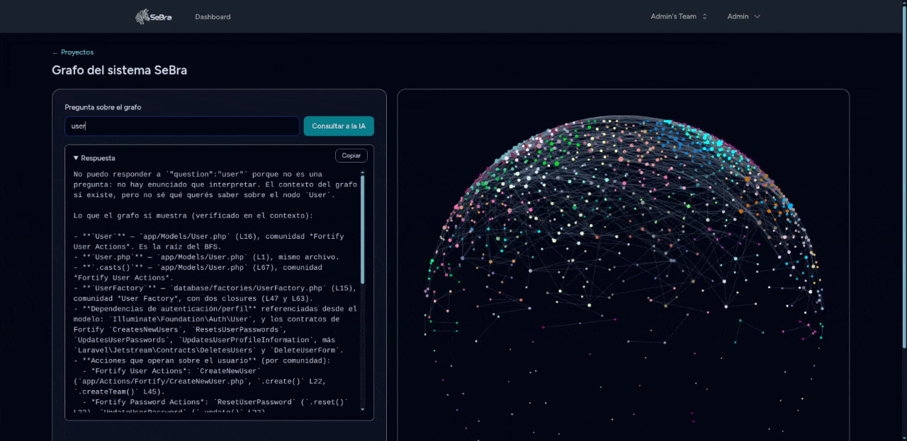

# SeBra — Second Brain


Aplicación Laravel 13 con Jetstream/Livewire, equipos, proyectos, notas Markdown, recuperación Graphify, IA configurable, voz por turnos y visualización Three.js con giro y resaltado temporal de comunidades; el backend conserva IDs verificados.

## Demostración



## Política obligatoria Docker-First

**PHP y todas sus herramientas se ejecutan exclusivamente dentro de Docker.** Incluye Composer, Artisan, PHPUnit, Pint, Boost/MCP, migraciones, seeders, workers, scheduler y extensiones. No instalar ni usar PHP, Composer o Laravel Installer en el host; tampoco invocarlos mediante rutas absolutas o shebangs de `vendor/bin`.

El host puede editar archivos, ejecutar Docker y herramientas externas sin PHP local, como Node/Vite y Python/Graphify. Si falta un contenedor o hay problemas de permisos, diagnosticar; no volver a un runtime local. `AGENTS.md` y `CLAUDE.md` establecen la misma regla para agentes futuros.

## Servicios y verificación de lectura

Los servicios de `compose.yaml` son `web`, `redis`, `project-import-worker` y `graph-watcher`. El volumen externo de SQLite es `laravel-sqlite_app`; Redis usa el volumen del proyecto `sphere-events`. No eliminarlos para reparar el entorno.

```sh
docker compose config --services
docker compose ps --all
docker compose exec -T web php -v
docker compose exec -T web composer --version
docker compose exec -T web php artisan --version
docker compose exec -T web php artisan route:list
docker compose exec -T web composer --no-plugins check-platform-reqs
docker compose exec -T redis redis-cli ping
docker compose exec -T web /opt/graphify/bin/python -c 'from importlib.metadata import version; print(version("graphifyy"))'
```

En el host auditado Docker está activo. Si la cuenta ya pertenece a `docker` pero el shell no refleja ese grupo, renovar la sesión; para un comando autorizado también puede usarse `sg docker -c 'docker compose ps --all'`. No usar `chmod 666` sobre el socket ni cambiar membresías automáticamente.

`compose exec` necesita que el servicio esté activo. No ejecutar `up`, `restart` ni `run` como diagnóstico automático: `start-laravel.sh` puede crear configuración y ejecutar migraciones al arrancar `web`. Un `compose run web` sin overrides hereda los volúmenes persistentes. Las operaciones de arranque/despliegue deben planificarse por separado.

## Desarrollo habitual

Comandos que modifican dependencias o archivos, únicamente dentro de una tarea de desarrollo autorizada:

```sh
docker compose exec -T web composer install
docker compose exec -T web php artisan make:class Support/NombreDeClase --no-interaction
docker compose exec -T web php vendor/bin/pint app/Support/NombreDeClase.php --format agent
```

No reinstalar Boost como bootstrap de cada sesión. Está en las dependencias de desarrollo; `.mcp.json` ejecuta `boost:mcp` mediante `docker compose exec`, con entorno CLI local, SQLite en memoria y `APP_CONFIG_CACHE=/tmp/sebra-boost-config-disabled.php` para no cargar la configuración productiva cacheada. En producción el paquete no registra sus comandos sin ese entorno CLI; no es motivo para instalarlo en el host. No limpiar cachés productivas automáticamente para preparar herramientas de desarrollo.

**No ejecutar `composer run setup` en la imagen actual:** incluye migraciones y NPM. Node y NPM no están instalados en la imagen PHP. Composer se ejecuta en Docker; las tareas puramente JavaScript pueden ejecutarse en el host:

```sh
npm ci
npm run build
# Alternativa con node_modules ya instalado:
node node_modules/vite/bin/vite.js build
```

Las migraciones y seeders, cuando la tarea los autorice, usan siempre `docker compose exec -T web php artisan ...`; no deben ejecutarse durante una auditoría de lectura. No se añade un scheduler: no hay tareas propias programadas actualmente. Workers y watcher ya son servicios Compose separados; no arrancar un segundo worker en el host.

## Pruebas PHP aisladas

`tests/TestCase.php` fuerza SQLite `:memory:` y rechaza una conexión distinta. No ejecutar pruebas sobre la base del volumen. Para no escribir vistas compiladas ni logs en el proyecto montado, usar un directorio temporal del contenedor y stderr:

```sh
docker compose exec -T \
  -e APP_ENV=testing -e DB_CONNECTION=sqlite -e DB_DATABASE=:memory: -e DB_URL= \
  -e CACHE_STORE=array -e SESSION_DRIVER=array -e LOG_CHANNEL=stderr \
  -e VIEW_COMPILED_PATH=/tmp/sebra-test-views \
  web sh -c 'mkdir -p /tmp/sebra-test-views && php vendor/bin/phpunit --do-not-cache-result'
```

Este comando es para una ejecución de pruebas autorizada, no una verificación productiva de lectura. Escribe artefactos temporales dentro del contenedor; no se ejecutó durante la auditoría Docker-First. Si hay caché de configuración que impide los overrides, la guardia de tests debe fallar: no quitarla ni limpiar configuración productiva automáticamente. Para separación más fuerte, preparar una instancia de desarrollo con los servicios existentes y volúmenes propios, sin heredar el volumen productivo mediante un `run` sin overrides.

Para tests focalizados añadir la ruta del test después de `vendor/bin/phpunit`. Puede usarse `docker compose exec web php artisan test` en un entorno de desarrollo aislado; se prefiere el comando anterior para controlar explícitamente artefactos y conexión.

## Pruebas JavaScript, navegador y adaptador

```sh
node --test tests/js/graph-selection.test.mjs
node --test tests/js/voice.test.mjs
docker compose exec -T web /opt/graphify/bin/python tests/graphify_query_test.py
```

Las pruebas de navegador usan Node/Chromium del host, pero renderizan Blade mediante Docker en `web`, con SQLite en memoria, vistas compiladas en un directorio temporal único y limpieza de ese directorio. Ya no aceptan `SEBRA_TEST_PHP` ni ejecutan PHP local. Para una prueba exclusivamente JavaScript también puede usarse `SEBRA_VOICE_FIXTURE_HTML=/ruta/fixture.html`, con un HTML ya renderizado: esa modalidad no arranca PHP ni modifica contenedores. Necesitan acceso a Docker y un servicio `web` disponible. Los micrófonos, voces y proveedores HTTP están simulados. No ejecutarlas como auditoría estrictamente de lectura de un contenedor productivo, porque crean temporales internos.

## Audio y estado de la imagen

`Dockerfile` incorpora FFmpeg/ffprobe y los límites de upload para STT. La imagen activa inspeccionada aún no incluye esos binarios; debe reconstruirse en una tarea de mantenimiento autorizada. No se reconstruyó ni reinició durante la auditoría. El audio nativo de navegador no necesita ffprobe; STT backend falla de forma cerrada si falta el inspector.

STT y TTS son independientes (`browser`, `compatible`, `disabled`). Las claves permanecen en backend. No se guardan grabaciones por defecto. Consultar [VOICE_INTERFACE.md](VOICE_INTERFACE.md).

## Documentación y estado funcional

- [SEBRA_POST_IMPLEMENTATION_AUDIT.md](SEBRA_POST_IMPLEMENTATION_AUDIT.md): Docker-First, inventario del host, evidencias y limpieza pendiente de autorización.
- [SEBRA_AUDIT.md](SEBRA_AUDIT.md): auditoría histórica inicial; sus ejecuciones locales previas no autorizan repetirlas.
- [SEMANTIC_QUERIES.md](SEMANTIC_QUERIES.md): interpretación y consultas de solo lectura.
- [GRAPH_NAVIGATION.md](GRAPH_NAVIGATION.md): selección, foco, restauración, límites y pruebas.
- [VOICE_INTERFACE.md](VOICE_INTERFACE.md): proveedores, consentimiento y audio por turnos.

Las conversaciones persistentes están pospuestas por decisión del usuario. No confundir los eventos Redis con historial durable.

## Limpieza del anfitrión

El inventario, los comandos exactos y el resultado de la limpieza autorizada están en la auditoría posterior. La instalación local de Herd Lite introducida para SeBra ya se retiró; las caches compartidas se conservaron. No ejecutar el desinstalador recursivo de Herd Lite, ni `autoremove`, `prune` o eliminaciones masivas. Se requiere autorización explícita antes de borrar los componentes locales atribuibles a SeBra o modificar los exports de shell. Conservar `vendor/`, bases, volúmenes, imágenes necesarias, caches compartidas y herramientas externas de origen incierto.
